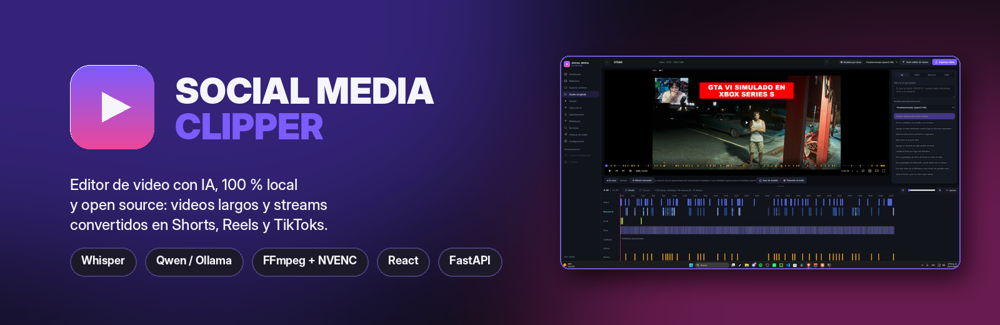
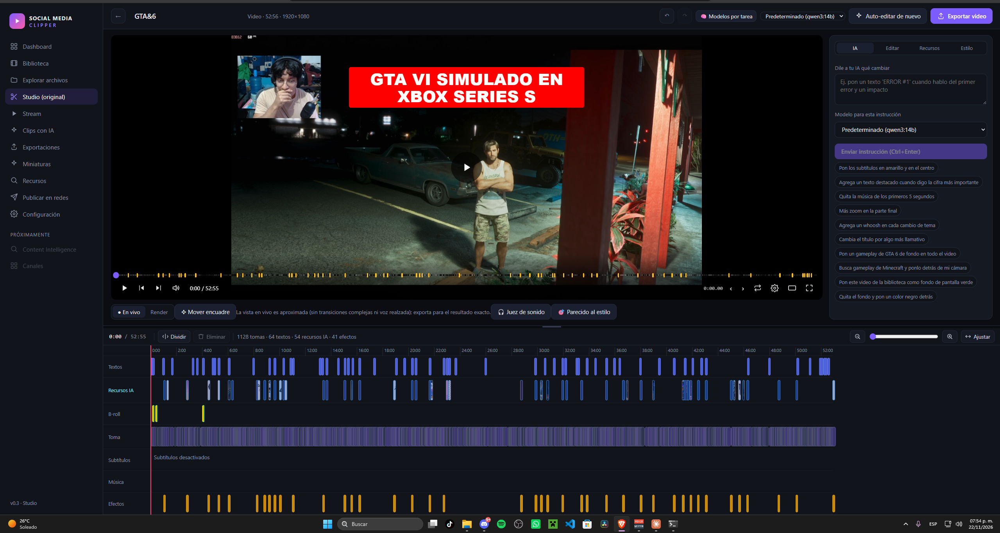
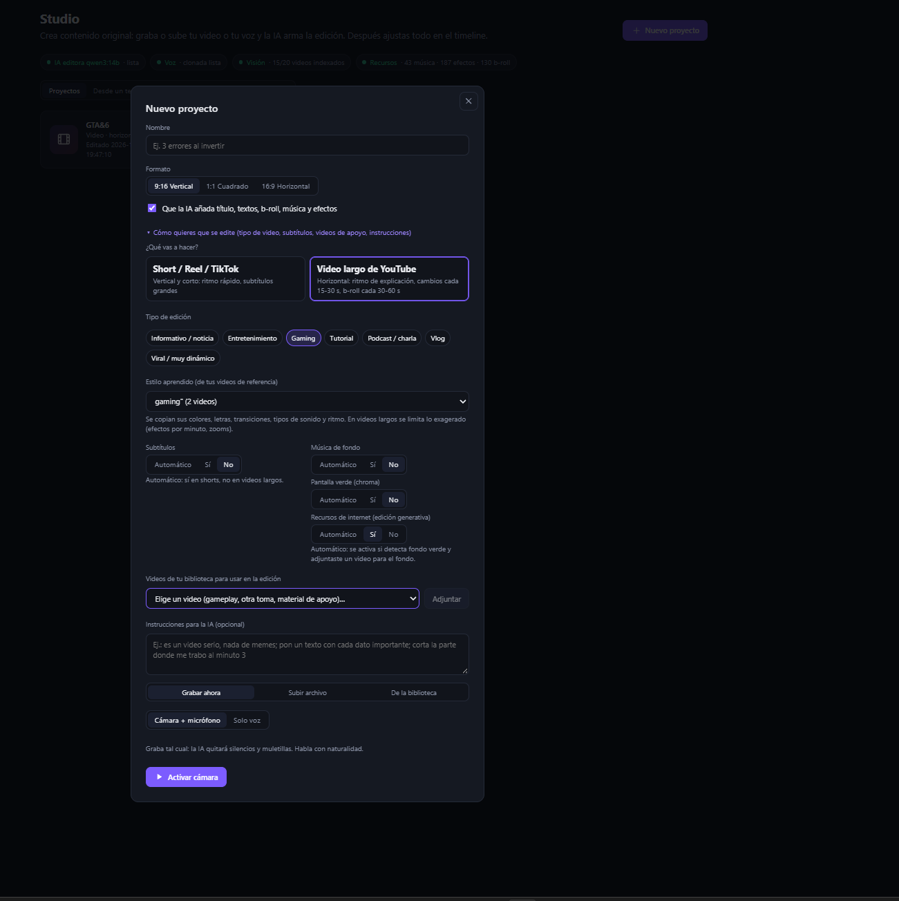
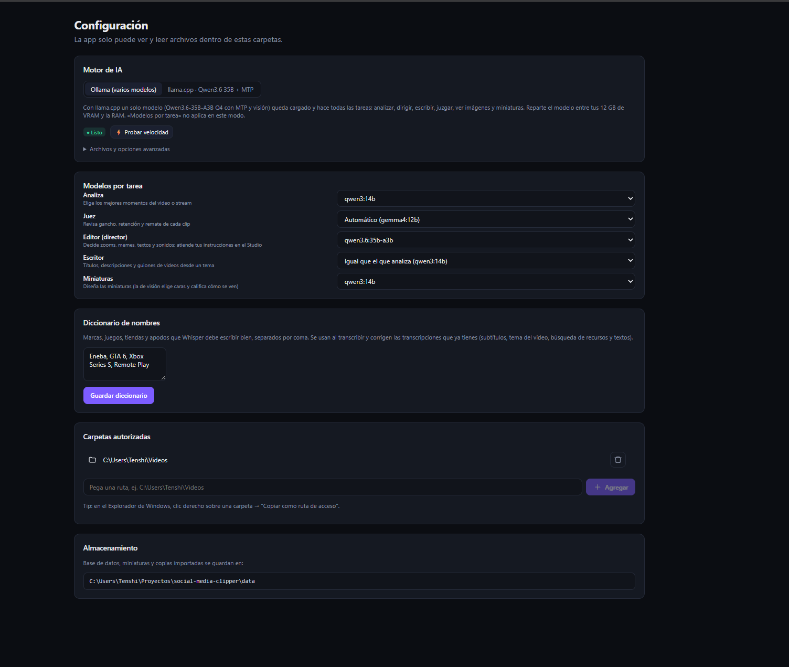
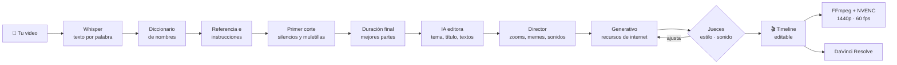

<p align="center">
  
</p>

<p align="center">
  <b>Convierte tus videos largos y streams en Shorts, Reels y TikToks con IA que corre en tu propia PC.</b><br>
  Sin suscripciones, sin subir tus videos a la nube y sin marcas de agua.
</p>

<p align="center">
  <a href="LICENSE"></a>
  
  
  
  
  
  <a href="https://github.com/AngelNotario/social-media-clipper/actions/workflows/ci.yml"></a>
</p>

<p align="center">
  <a href="#-qué-hace">Qué hace</a> ·
  <a href="#-instalación">Instalación</a> ·
  <a href="#-cómo-funciona-la-edición-con-ia">Cómo funciona</a> ·
  <a href="#-contribuir">Contribuir</a> ·
  <a href="#-english">English</a>
</p>

---

**Social Media Clipper** es una alternativa local y de código abierto a herramientas como OpusClip: le das un video
largo, un podcast o la grabación de tu stream, y la IA encuentra los mejores momentos, los recorta en vertical con tu
cara siempre en cuadro, les pone subtítulos animados, títulos, efectos de sonido, imágenes de apoyo de internet y música,
y te deja todo en un editor con timeline para ajustarlo antes de exportar o publicar.

Todo pasa en tu computadora: la transcripción (Whisper), el "cerebro" editor (Qwen vía Ollama o llama.cpp), la visión
artificial y el render (FFmpeg con aceleración NVIDIA). Tus videos nunca salen de tu PC.

<p align="center">
  
</p>

## ✨ Qué hace

| | Función | Qué obtienes |
|---|---|---|
| ✂️ | **Clips con IA** | Elige un video y la IA propone los mejores momentos con puntuación de gancho, emoción, valor y retención. Los ajustas, apruebas y exportas en 9:16. |
| 🎬 | **Studio** | Graba en la app o usa tu video: quita silencios y muletillas, corta, hace zooms, pone títulos, textos, b-roll, música y efectos. Después lo ajustas en un timeline con pistas. |
| 🎮 | **Modo Stream** | Para grabaciones de OBS: detecta tu cámara, arma clips con cámara arriba y juego abajo, y un resumen para YouTube con capítulos. |
| 🌐 | **Edición generativa** | Busca en internet imágenes, logos y clips reales de lo que mencionas, los verifica con visión artificial y los guarda en tu biblioteca de recursos. Nada se inventa. |
| 🎨 | **Estilos aprendidos** | Le das un video de referencia y la app aprende su ritmo, colores, tipografía, subtítulos y sonidos; un juez compara cada edición contra tu referencia. |
| 🗣️ | **Instrucciones en lenguaje natural** | *"Pon los subtítulos en amarillo y al centro"*, *"quita la música de los primeros 5 segundos"*, *"pon un gameplay de fondo"*. |
| ⏱️ | **Duración final** | Pide "10 minutos" y la IA se queda con las partes más importantes, sin cortar frases. |
| 🔊 | **Juez de sonido** | Revisa que los efectos tengan sentido y no saturen, y deja la voz a -14 LUFS (el estándar de YouTube). |
| 📖 | **Diccionario de nombres** | Whisper aprende cómo se escriben las marcas, juegos y apodos que mencionas, y aprende también de tus correcciones de subtítulos. |
| 🖼️ | **Miniaturas** | Diseña miniaturas con tu cara y texto llamativo, calificadas por visión artificial. |
| 📤 | **Publicar** | Textos por red (YouTube, Instagram, TikTok) generados por la IA y publicación con las APIs oficiales. |
| 🎞️ | **DaVinci Resolve** | Exporta tu proyecto (cortes, recursos, textos, música y subtítulos) para terminarlo en Resolve. |
| 🏆 | **Máxima calidad** | Exporta a 1440p y 60 fps con NVENC, para que YouTube use su mejor compresión. |

<details>
<summary><b>Más capturas</b></summary>
<br>
<p align="center">
  
  
</p>
</details>

## 🚀 Instalación

### Requisitos

| | Mínimo | Recomendado |
|---|---|---|
| Sistema | Windows 10/11 (también corre en Linux) | Windows 11 |
| GPU | Cualquiera (sin GPU la IA va más lenta) | NVIDIA RTX con 12 GB de VRAM (probado en una RTX 5070) |
| RAM | 16 GB | 32–40 GB para modelos grandes |
| Software | [Python 3.12](https://www.python.org/downloads/), [Node.js 20+](https://nodejs.org/), [FFmpeg](https://www.gyan.dev/ffmpeg/builds/) en el PATH | además [Ollama](https://ollama.com/) para la IA |

### Pasos

```bash
git clone https://github.com/AngelNotario/social-media-clipper.git
cd social-media-clipper
```

1. **Descarga los modelos de IA** (una sola vez):
   ```bash
   ollama pull qwen3:14b          # analiza y escribe
   ollama pull qwen3.6:35b-a3b    # editor/director (con visión)
   ```
   Whisper `large-v3-turbo` se descarga solo la primera vez que transcribes.
2. **Inicia la app**: doble clic en **`start.bat`**. La primera vez crea el entorno de Python e instala la
   interfaz (1–2 minutos) y luego abre **http://localhost:8000**.
3. **Configuración → Carpetas autorizadas**: agrega la carpeta donde guardas tus videos (por ejemplo la de OBS). La
   Biblioteca la refleja en tiempo real: los videos nuevos aparecen solos.

> En Linux o macOS: `cd backend && python -m venv .venv && .venv/bin/pip install -r requirements.txt`, después
> `cd ../frontend && npm install && npm run build`, y por último `cd ../backend && .venv/bin/uvicorn app.main:app --port 8000`.

**Modo desarrollo:** `dev.bat` abre el backend con recarga automática y Vite con recarga en caliente (http://localhost:5173).

### Opcional

- **llama.cpp** (Configuración → Motor de IA): un solo modelo Qwen3.6 35B con MTP para todas las tareas.
  `tools/llamacpp/descargar.ps1` descarga el servidor y el modelo.
- **Voz clonada**: Chatterbox Multilingual (local) en un entorno aparte (`backend/.venv-tts`).
- **Publicar en redes**: crea tus propias credenciales OAuth (Google Cloud / Meta / TikTok) y conéctalas desde
  *Publicar en redes*. Nunca subas tus archivos de credenciales al repositorio.

## 🧠 Cómo funciona la edición con IA



1. **Transcripción**: Whisper `large-v3-turbo` en la GPU, con tiempos por palabra y tu diccionario de nombres.
2. **La referencia manda**: si eliges un estilo aprendido, sus zooms, transiciones, subtítulos y música guían todo el
   proceso desde el inicio; tus instrucciones también se convierten en ajustes antes de editar.
3. **Primer corte**: quita pausas y muletillas (jump cuts) y, si pediste una duración, se queda con las mejores partes.
4. **IA editora y director** (Qwen): entiende el tema, investiga en la web, escribe título y textos, y decide zooms,
   memes y efectos en los momentos de más energía.
5. **Edición generativa**: busca recursos reales de lo que dices, los verifica con visión y los coloca sin tapar tu cara.
6. **Jueces**: el de estilo compara contra tu referencia y ajusta; el de sonido quita lo que sobra y normaliza a -14 LUFS.
7. **Timeline**: todo queda editable (textos, recursos, subtítulos, música, efectos) antes del render final.

## 🗂️ Estructura

```
social-media-clipper/
├── start.bat · dev.bat         Arranque (producción / desarrollo)
├── backend/                    FastAPI + SQLite + FFmpeg
│   ├── app/
│   │   ├── ai/                 Whisper, LLM (Ollama / llama.cpp), visión, diccionario, análisis de clips
│   │   ├── studio/             Timeline, auto-edición, director, generativo, jueces, render, Resolve
│   │   ├── resources/          Planeador, buscador e índice de recursos de internet
│   │   ├── editor/             Encuadre de rostro, subtítulos, render de clips, control de calidad
│   │   ├── publish/            OAuth y publicación con APIs oficiales
│   │   ├── thumbs/             Miniaturas
│   │   └── routers/            API REST (/api/...)
│   └── tests/                  Pruebas con pytest (Whisper y la IA se simulan; FFmpeg corre de verdad)
├── frontend/                   React 18 + Vite (sin librerías de UI)
├── docs/                       Arquitectura, capturas e imágenes
└── tools/                      Scripts de apoyo (llama.cpp, túnel)
```

Más detalle en [docs/ARQUITECTURA.md](docs/ARQUITECTURA.md). La API interactiva está en http://localhost:8000/docs.

## 🔒 Privacidad y seguridad

- La app solo puede leer archivos dentro de las **carpetas que autorizas**.
- La IA corre en tu PC. Lo único que sale a internet es la búsqueda de recursos (imágenes y clips públicos) y la
  publicación cuando tú la pides, siempre con las APIs oficiales.
- Tus datos (base de datos, sesiones de redes, copias) viven en `data/`, que nunca se sube al repositorio.

## 🧪 Pruebas

```bash
cd backend
.venv\Scripts\python -m pytest -q      # Windows
.venv/bin/python -m pytest -q          # Linux / macOS
```

Más de 160 pruebas: cortes, timeline, IA (con dobles de prueba), render real con FFmpeg, jueces, publicación y
exportación a Resolve.

## 🛣️ Hoja de ruta

- [ ] Instalador para Windows con un clic
- [ ] Selector de carpetas nativo
- [ ] Más idiomas en la interfaz (inglés)
- [ ] Plantillas de estilo compartibles
- [ ] Publicación programada

¿Tienes una idea? Abre un [issue](https://github.com/AngelNotario/social-media-clipper/issues/new/choose).

## 🤝 Contribuir

¡Las contribuciones son bienvenidas! Lee [CONTRIBUTING.md](CONTRIBUTING.md) para preparar tu entorno, el estilo del
código y cómo enviar un pull request. Al participar aceptas el [código de conducta](CODE_OF_CONDUCT.md).

Si la app te sirve, **dale una ⭐ al repositorio**: ayuda a que más creadores la encuentren.

## 🙏 Créditos

- [faster-whisper](https://github.com/SYSTRAN/faster-whisper) · [Ollama](https://ollama.com/) ·
  [llama.cpp](https://github.com/ggml-org/llama.cpp) · [Qwen](https://github.com/QwenLM) ·
  [FFmpeg](https://ffmpeg.org/) · [OpenCV YuNet](https://github.com/opencv/opencv_zoo) ·
  [Chatterbox](https://github.com/resemble-ai/chatterbox) · [FastAPI](https://fastapi.tiangolo.com/) · [React](https://react.dev/)
- Efectos de sonido de [Kenney](https://kenney.nl/) (CC0) y música de [FreePD](https://freepd.com/) (CC0).

## 📄 Licencia

[MIT](LICENSE) © AngelNotario. Usa la app con contenido que tengas derecho a usar: aprobar o exportar un clip no
te da derechos sobre el material de terceros.

---

## 🇺🇸 English

**Social Media Clipper** is a free, open-source, **100 % local** alternative to OpusClip. Feed it a long video, podcast
or stream recording and it finds the best moments, reframes them to vertical with your face always in frame, and adds
animated captions, titles, sound effects, real B-roll found on the web, and music. Everything ends up in a timeline
editor you can tweak before exporting (1440p / 60 fps with NVENC), publishing through official APIs, or sending to
**DaVinci Resolve** (FCPXML).

Everything runs on your machine: Whisper for transcription, Qwen (via Ollama or llama.cpp) as the editor brain, vision
models, and FFmpeg for rendering. Your videos never leave your PC.

**Quick start:** install Python 3.12, Node.js 20+, FFmpeg and Ollama, then `ollama pull qwen3:14b`, clone the repo and
run `start.bat` (Windows). The app opens at http://localhost:8000. The UI is currently in Spanish; English translation
is on the roadmap and contributions are welcome. Licensed under [MIT](LICENSE).
